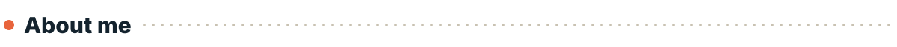
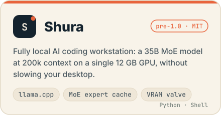
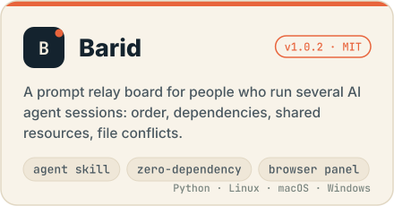
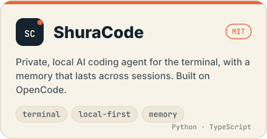
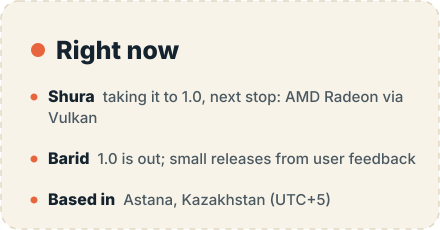
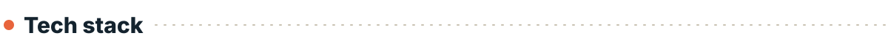
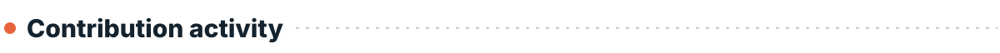

<picture>
  <source media="(prefers-color-scheme: dark)" srcset="assets/header-dark.svg">
  
</picture>

<picture>
  <source media="(prefers-color-scheme: dark)" srcset="assets/title-about-dark.svg">
  
</picture>

I'm a full stack engineer from Astana, Kazakhstan, working mostly in **Go, Python and TypeScript**. Lately I build tools for running AI locally and for working with several AI agents at once.

- 🖥️ **[Shura](https://github.com/hikkian/shura)**: a 35B coding model on one 12 GB gaming GPU, fully offline, tuned so the desktop stays smooth
- 📮 **[Barid](https://github.com/hikkian/barid)**: a relay board that keeps several AI agent sessions in order, released as 1.0
- ⚙️ Backend work: REST APIs, Strapi, FastAPI, PostgreSQL, JWT / OAuth 2.0, Docker, Nginx
- 🏅 Bronze at the International Eurasian Olympiad in Informatics and at the Kazakhstan National Olympiad in Informatics
- 🗣️ Kazakh and Russian (native), English (B2)

<picture>
  <source media="(prefers-color-scheme: dark)" srcset="assets/title-projects-dark.svg">
  
</picture>

  <a href="https://github.com/hikkian/shura"><picture><source media="(prefers-color-scheme: dark)" srcset="assets/card-shura-dark.svg"></picture></a>
  <a href="https://github.com/hikkian/barid"><picture><source media="(prefers-color-scheme: dark)" srcset="assets/card-barid-dark.svg"></picture></a>
  <a href="https://github.com/hikkian/shuracode"><picture><source media="(prefers-color-scheme: dark)" srcset="assets/card-shuracode-dark.svg"></picture></a>
  <picture><source media="(prefers-color-scheme: dark)" srcset="assets/card-now-dark.svg"></picture>

<picture>
  <source media="(prefers-color-scheme: dark)" srcset="assets/title-stack-dark.svg">
  
</picture>

  <picture>
    <source media="(prefers-color-scheme: dark)" srcset="https://skillicons.dev/icons?i=go%2Cpy%2Cts%2Cjs%2Ccpp%2Cnodejs%2Creact%2Cfastapi%2Cpostgres%2Cdocker%2Cnginx%2Clinux%2Cbash%2Cgit%2Cgithubactions&theme=dark&perline=15">
    
  </picture>

<b>AI / LLM:</b> <code>llama.cpp</code> · <code>local inference</code> · <code>RAG</code> · <code>Qdrant</code> · <code>Gemini API</code> · <code>Claude Code</code> · <code>Codex</code>

<picture>
  <source media="(prefers-color-scheme: dark)" srcset="assets/title-activity-dark.svg">
  
</picture>

<picture>
  <source media="(prefers-color-scheme: dark)" srcset="https://raw.githubusercontent.com/hikkian/hikkian/output/snake-dark.svg">
  
</picture>

<picture>
  <source media="(prefers-color-scheme: dark)" srcset="assets/footer-dark.svg">
  
</picture>
